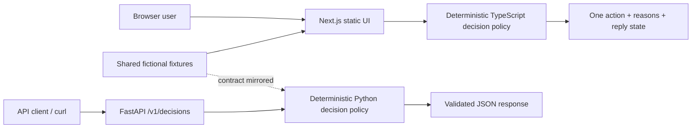
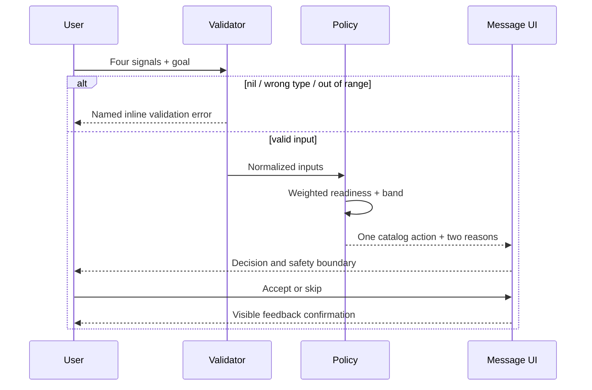

# Architecture

## Prototype topology

GitHub Pages hosts only the static frontend. The Python service is runnable locally and tested in CI; it is not deployed. The frontend mirrors the small policy locally so the public demo remains functional without pretending Pages can host FastAPI.

## Decision flow and shadow paths

Empty state is intentional before generation. The browser demo has no upstream network, eliminating timeout and partial-response behavior. A production client must add request IDs, a 5-second timeout, retry only before delivery, idempotency keys, and a visible “no decision delivered” state.

## Production boundary

- Adapter layer per wearable normalizes units, timestamps, and baseline windows.
- Policy service accepts normalized inputs and emits only approved action IDs.
- Messaging worker owns quiet hours, idempotent delivery, opt-out, and reply parsing.
- Append-only feedback events support audit and learning.
- Safety rules execute before personalization and fail closed.
- Observability includes decision latency, no-decision rate, delivery failures, action acceptance, completion, safety-rule frequency, deletion SLA, and policy-version distribution.
